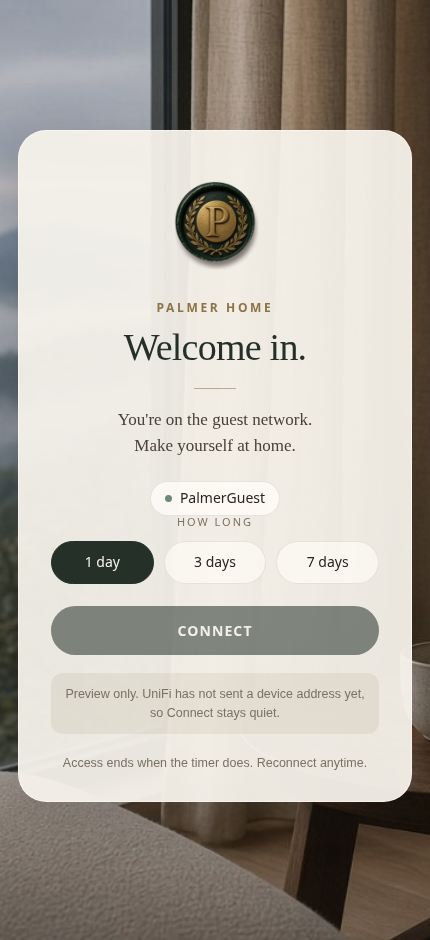
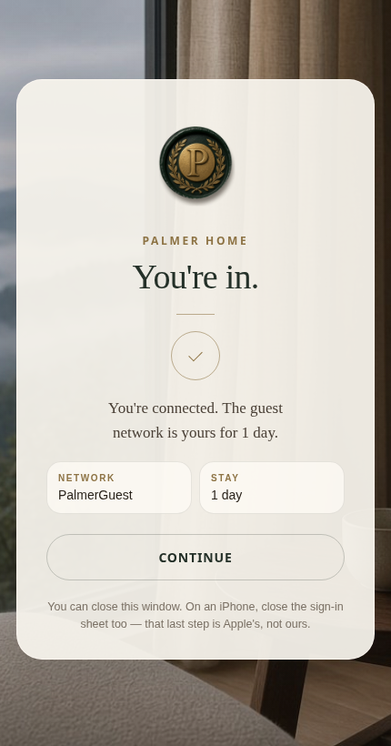

# PalmerGuest external portal

Landing page for Palmer Home guest Wi-Fi, built for **UniFi Controller 5.1.33** and an Unraid Docker host.

UniFi 5.1 does not host this page. It redirects a guest to this server, and this server calls the controller back to authorize the device.

## What the guest sees

The hotspot is open. There is no guest password. A guest picks how long to stay, then Connect.

A self-contained page (no outside fonts or scripts, which captive-portal clients cannot load before they are authorized):

- Palmer Home seal, calm interior
- SSID `PalmerGuest`
- 1 day / 3 days / 7 days
- Connect, then a Palmer Home success page

Landing page:



Success page:



## How UniFi 5.1.33 talks to it

On join, the AP redirects the phone to:

```
http://<portal-ip>/guest/s/default/?id=<client-mac>&ap=<ap-mac>&t=<unix>&url=<original>&ssid=PalmerGuest
```

`id` is the phone. After Connect, the container logs into the controller and posts:

```
POST https://<controller>:8443/api/login
POST https://<controller>:8443/api/s/default/cmd/stamgr
{"cmd":"authorize-guest","mac":"<client-mac>","minutes":720}
```

That is the 5.1 API, not the newer UniFi OS `/proxy/network` or `/v1/sites/.../actions` API. If the raw JSON call is rejected, the server retries the older `json=` form body.

## 1. Controller account

In the 5.1 controller, create a local admin used only by this portal (Settings → Admins). `authorize-guest` needs a read/write admin, not a read-only account. Put that username and password in `docker-compose.yml`.

Default site id on a single-site 5.1 controller is `default`. If Settings → Site shows a different id, set `UNIFI_SITE` to it. The redirect path `/guest/s/<site>/` is also read and preferred.

## 2. Unraid

Copy this folder to the Unraid host, edit `docker-compose.yml`, then:

```
docker compose up -d --build
```

UniFi 5.1 always redirects to **port 80** of the portal IP (port 443 only if Secure Portal is on — don’t turn that on; the certificate warning breaks phones).

If Unraid’s Nginx or Nginx Proxy Manager already owns port 80, give the container its own LAN address instead of publishing 80 on the host. Example, adjust to your subnet and Unraid `br0` network name:

```yaml
services:
  palmer-guest-portal:
    ports: !reset []
    networks:
      br0:
        ipv4_address: 192.168.1.50
networks:
  br0:
    external: true
```

The controller must be reachable from the container at `UNIFI_URL` (the Java controller port, normally `https://<controller-ip>:8443`). Self-signed certs are accepted.

Open `http://<portal-ip>/preview` for the welcome card, and `http://<portal-ip>/success` for the connected page. Connect stays disabled on the preview because UniFi has not sent a MAC yet. After a real authorization, the phone lands on that success page and can close the captive sheet.

`./data/access.log` records time, MAC, and success/failure. It does not record the password or browsing.

## 3. UniFi 5.1.33 Guest Control

Settings → Guest Control:

1. Enable Guest Portal.
2. Authentication: **External Portal Server**.
3. Custom portal IP: the portal container’s LAN IP. Not a hostname.
4. Leave **Redirect using hostname** off. Pre-auth DNS is intercepted, so a name often fails.
5. Leave **Secure Portal** off.
6. Pre-Authorization Access: add the portal IP as a single host (`192.168.1.50/32`). Guests cannot reach the page without this.
7. Also allow nothing else you don’t mean to expose. The controller IP does not need to be in pre-auth; the portal container calls the controller, the phone does not.
8. Expiration in this screen is overridden by the minutes this portal sends.

Settings → Wireless Networks → `PalmerGuest`:

- Guest Policy enabled. Without that checkbox the portal never triggers.
- Apply guest policies / client isolation on, so guests cannot see the house LAN.

Then forget the network on a phone, join `PalmerGuest`, and open any plain `http://` page (or let the captive sheet appear).

## Optional rate cap

`UP_KBPS` and `DOWN_KBPS` are kilobits per second on the authorize call (`up` / `down` in the 5.1 stamgr payload). Blank means unlimited. Example: `UP_KBPS=5000` and `DOWN_KBPS=20000` for about 5 / 20 Mbps.

## If a phone reaches the page but never gets online

- Portal log shows `login failed`: wrong URL, user, or password, or the container cannot reach `:8443`.
- Portal log shows `authorize failed`: site id is not `default`, or the MAC was not actually associated yet. Rejoin and retry.
- Page never loads: portal IP missing from Pre-Authorization Access, or the redirect is going to port 80 on an IP that is not this container.
- iPhone sheet stays up after success: close it. That sheet is Apple’s, not the portal.
